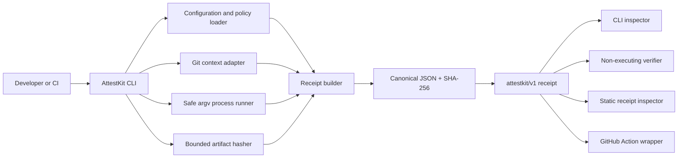

# AttestKit Architecture

## Architecture decision

AttestKit is a TypeScript monorepo with a pure protocol core shared by a Node.js CLI, a static React inspector, and a GitHub Action wrapper. The design follows a practical hexagonal boundary: the domain defines the receipt schema, canonicalization, integrity model, and typed findings; adapters gather process, Git, filesystem, and GitHub facts; presenters render terminal, JSON, Markdown, and browser views. No domain module imports a command runner, React, GitHub API, or filesystem implementation.



## Repository layout

| Path              | Responsibility                                                                 |
| ----------------- | ------------------------------------------------------------------------------ |
| `packages/core`   | Schema, canonical JSON, integrity, redaction, policy evaluation, result types. |
| `packages/cli`    | Commands, filesystem/process/Git adapters, stable exit semantics, renderers.   |
| `packages/action` | Thin GitHub Actions integration; never evaluates PR text as shell code.        |
| `client`          | Static browser receipt inspector and product documentation surface.            |
| `examples`        | Safe sample receipts, configuration, and GitHub workflow.                      |
| `tests`           | Unit, integration, regression, and security fixtures.                          |

## Receipt protocol

Every receipt declares `schemaVersion: "attestkit/v1"`. The integrity boundary is the `payload` object. AttestKit sorts object keys recursively, serializes to UTF-8 canonical JSON, and stores the SHA-256 digest as `integrity.payloadSha256`. Fields that are inherently non-deterministic, such as `capturedAt`, are retained inside the payload for audit context; repeated captures need not share a digest, but a fixed fixture must.

```json
{
  "schemaVersion": "attestkit/v1",
  "payload": {
    "command": { "argv": ["pnpm", "test"], "exitCode": 0, "durationMs": 4821 },
    "source": { "head": "abc123", "dirty": false, "changedPaths": [] },
    "environment": { "platform": "linux", "runtime": { "node": "22.13.0" } },
    "evidence": [
      { "kind": "artifact", "path": "reports/junit.xml", "sha256": "..." }
    ],
    "redaction": { "profile": "default", "applied": ["token-like-values"] }
  },
  "integrity": { "algorithm": "sha256", "payloadSha256": "..." }
}
```

## Data and error flow

`capture` validates configuration, canonicalizes the requested workspace root, gathers bounded Git/environment facts, runs a user-supplied argv array without a shell, applies redaction before persistence, hashes explicitly declared artifacts, builds the schema-valid payload, and writes the receipt atomically. A non-zero target command becomes a valid receipt with `status: "failed"`; malformed configuration, path escape, unreadable artifact, process launch failure, or invalid protocol data is an analysis error.

| Exit code | Meaning                                                                                                     |
| --------: | ----------------------------------------------------------------------------------------------------------- |
|         0 | Successful capture, inspection, or verification with a successful target command where relevant.            |
|         1 | A captured target command failed, a receipt integrity check failed, or an enforced policy finding occurred. |
|         2 | Invalid input, invalid configuration, unsafe path, missing artifact, or protocol validation error.          |
|         3 | Receipt is structurally valid but cannot be compared or independently verified in the available workspace.  |

## Security model

The system is local-first by default and makes no network request in core commands. Capture executes only an explicit argv sequence after `--`; it never calls a shell, parses a PR body as code, or invokes `eval`. Artifact inclusion is allowlisted by configuration, paths are resolved beneath the workspace root, symlinks are refused by default, byte and file count limits are enforced, and recognized secret values are redacted before receipt persistence. Verification never executes a captured command. The GitHub Action uses `pull_request` for untrusted contributions, requests read-only permissions unless an explicit artifact upload is required, and does not check out or execute untrusted fork content in a privileged `pull_request_target` context.

## Observability and privacy

The CLI emits structured JSON when requested and a human-readable timeline otherwise. It records only operational facts needed to interpret the receipt: timestamps, bounded duration, command argv, selected tool versions, capture warnings, and redaction counts. It never records environment values except a small safe allowlist; all other variables are represented as absent/present metadata. No telemetry, analytics, or automatic upload exists in the MVP.

## Performance and scale

Receipt construction is linear in the number of selected artifacts and captured bytes. Standard-output and standard-error are separately bounded; artifact hashing streams files rather than loading them wholesale. The default policy caps the number of files and maximum bytes per artifact. The initial supported deployment is a single developer workspace or a GitHub runner; future registry and comparison adapters remain outside the core domain.

## Extensibility

Providers implement small ports: `SourceContextProvider`, `ProcessRunner`, `ArtifactReader`, `Signer`, `ReceiptStore`, and `Renderer`. Protocol versions are explicit and new optional fields must remain backward-compatible. Policy rules are data-driven, emit stable IDs, and cannot execute code. New CI adapters should feed the same receipt builder rather than creating a separate manifest format.

## Implementation plan

1. Implement the pure protocol schema, canonicalizer, integrity verifier, and test fixtures.
2. Implement safe local adapters and the capture/inspect/verify CLI commands.
3. Add configuration, redaction, policy findings, examples, and stable renderer formats.
4. Build the static inspector to load and validate a local receipt in the browser.
5. Add the GitHub Action wrapper, quality workflows, security scan, and release automation.
